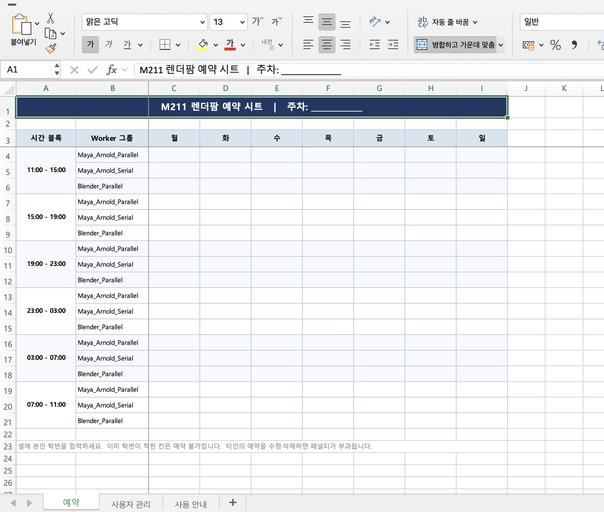

# 🗓 01 · 예약하기

렌더팜은 **예약한 시간에만** 쓸 수 있습니다. 예약 없이 제출하면 다른 사람 작업과 충돌합니다.

---

## 1-1. 먼저 — 등록되어 있나요?

예약 시트에 **내 학번이 등록**되어 있어야 예약할 수 있습니다. 미등록 학번을 입력하면 자동으로 지워집니다.

아직 등록이 안 되어 있다면 졸업준비위원회에 신청하세요. 신청할 때 필요한 것:

```
팀 프로젝트명
팀장 학번
이메일
프로젝트 분량 (분)
```

**프로젝트 분량에 따라 주당 쓸 수 있는 시간이 달라집니다.** 자세한 내용은 `09 · 타임블럭과 사용 규칙` 을 보세요.

---

## 1-2. 예약 시트 열기

졸준위가 공유한 구글 시트를 엽니다.



가로축이 **요일**, 세로축이 **시간 블록**입니다.

---

## 1-3. 타임블럭

**타임블럭 1개 = 4시간**입니다.

| | 사용 가능 시간 | 하루 블럭 수 |
| --- | --- | --- |
| **평일 (월~금)** | `19:00 ~ 11:00` | 4개 |
| **주말 (토·일)** | 24시간 | 6개 |

```
평일   19:00-23:00   23:00-03:00   03:00-07:00   07:00-11:00
주말   위 4개  +  11:00-15:00   15:00-19:00
```

> **평일 낮(11:00~19:00)은 수업 때문에 쓸 수 없습니다.** 실습실 PC를 수업에서 써야 하기 때문입니다.

---

## 1-4. 그룹 — 4팀이 동시에 돌릴 수 있습니다

실습실 PC는 **4개 그룹으로 나뉘어 있습니다.** 한 타임블럭에 4개 팀이 서로 방해 없이 동시에 렌더할 수 있습니다.

```
그룹 A  ─┐
그룹 B  ─┤  같은 시간에 네 팀이 동시에 렌더
그룹 C  ─┤
그룹 D  ─┘
```

예약할 때 **시간 + 그룹**을 함께 고릅니다. 제출할 때도 **예약한 그룹과 똑같이** 지정해야 합니다.

> 다른 그룹을 고르면 예약하지 않은 PC를 쓰게 되어 다른 팀 작업과 겹칩니다. 제출 창의 **`Pool`** 칸을 꼭 확인하세요. (`Group` 은 `none` 그대로)

**빈 칸에 본인 학번을 입력하면 예약됩니다.**

---

## 1-5. 주당 쓸 수 있는 양

| 라이선스 | 주 타임블럭 | 주 사용시간 |
| --- | --- | --- |
| 1 | 8 블럭 | 32시간 |
| 2 | 16 블럭 | 64시간 |
| 3 | 24 블럭 | 96시간 |

본인이 몇 개를 받았는지는 예약 시트의 `03_사용현황` 탭에 있습니다.

> 이것은 **상한선**입니다. 블록은 선착순이라 상한까지 꽉 채우지 못할 수도 있습니다.

---

## 1-6. 규칙

- 미등록 학번은 **자동으로 지워집니다**
- 남의 예약을 지우거나 덮어쓰지 마세요 — 수정 기록이 남습니다
- 안 쓸 블록은 **미리 비워주세요**. 그래야 다른 팀이 씁니다
- 제출할 때 **`Pool`** 을 예약한 레인과 똑같이 맞추세요
- **예약한 시간에만** Worker PC에 로그인하세요

> 심야 블록(`23:00-03:00`, `03:00-07:00`)이 가장 한가합니다. 렌더는 사람이 지켜보지 않아도 돌아가니, **저녁에 제출해두고 자는 방식**을 권합니다.

위반 시 처리 기준은 `09 · 타임블럭과 사용 규칙` 에 있습니다.
