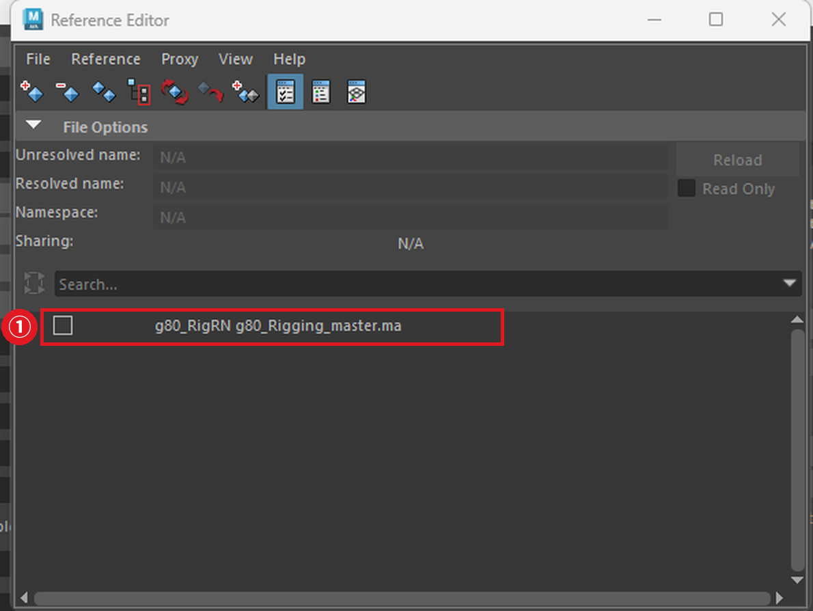
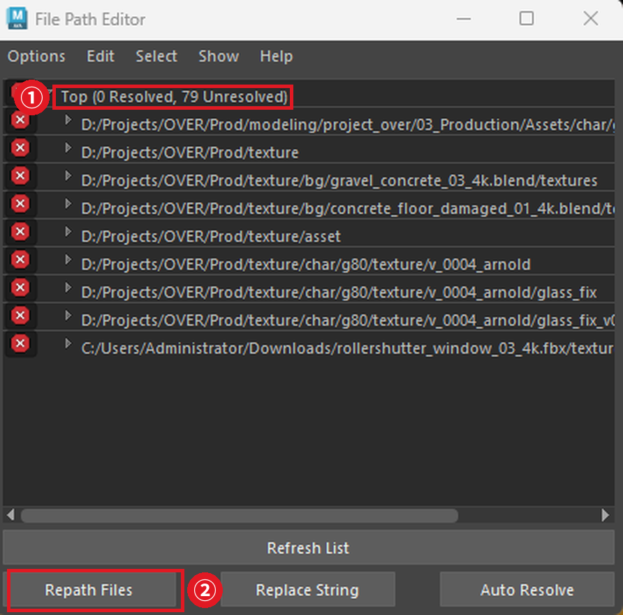
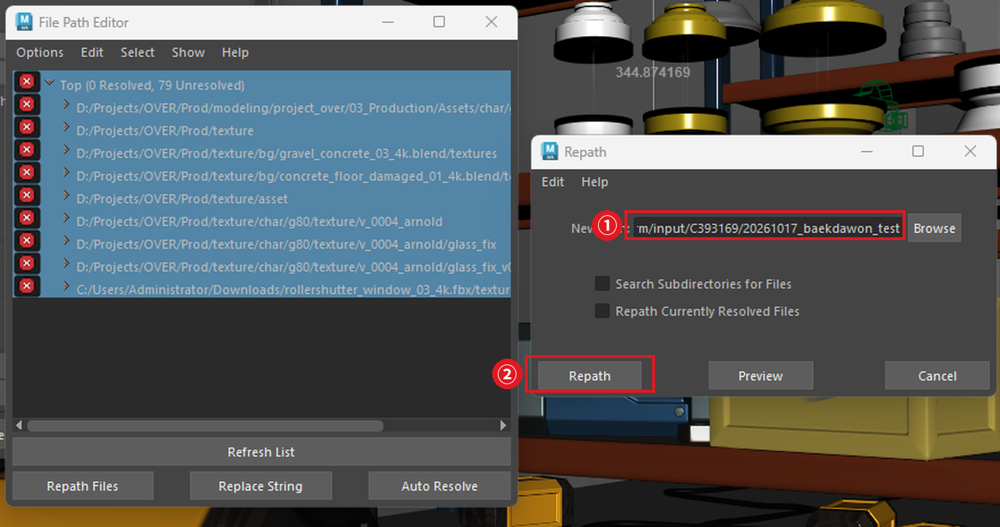
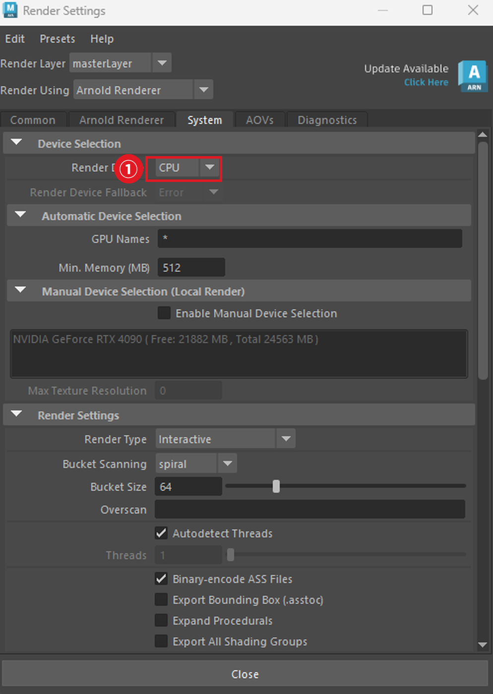
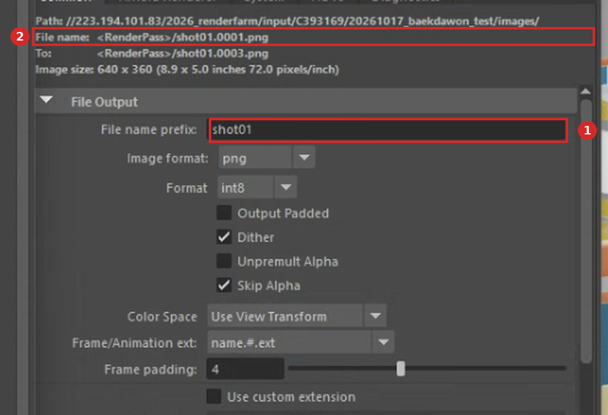

# 🅰 02 · 파일 준비 — 마야

> **렌더 실패의 대부분이 이 단계에서 생깁니다.** 대신 할 일은 네 가지뿐입니다.

```
1  레퍼런스를 Import로 바꾸기
2  모든 파일을 NAS 경로로
3  Render Device를 CPU로
4  출력 경로에 파일 이름 적기
```

마지막에 **`Ctrl + S`**. 저장 안 하면 아무것도 반영되지 않습니다.

---

## 마야 버전은 신경 쓰지 않아도 됩니다

렌더팜은 **어떤 버전으로 만든 씬이든 Maya 2026으로 렌더합니다.** 2025에서 작업하셔도 되고, 구버전 씬을 열 때 뜨는 "이전 버전 파일" 경고도 무시하셔도 됩니다.

---

## 1. 레퍼런스를 Import로 바꾸기

씬에 레퍼런스(Reference)가 걸려 있으면 **렌더할 때 통째로 빠집니다.** 캐릭터가 안 보이는 결과물이 나옵니다.

```
File → Reference Editor
→ 레퍼런스 선택 → Reference → Import Objects from Reference
```



**①** 걸려 있는 레퍼런스입니다. 선택한 뒤 `Reference → Import Objects from Reference` 를 누르세요.

> 원본 파일이 없으면 메뉴가 비활성화됩니다. 그때는 파일을 보낸 사람에게 원본을 먼저 받아야 합니다.

**레퍼런스가 없으면 건너뛰세요.**

---

## 2. 모든 파일을 NAS 경로로

핵심은 한 문장입니다.

> **내 PC에만 있는 파일은 Worker가 못 읽습니다.**

씬 파일 안에는 텍스처가 들어있지 않고 **"텍스처가 어디 있다"는 경로만** 적혀 있습니다. 그 경로가 내 노트북 `D:\` 를 가리키면, 렌더팜 PC에는 그런 데가 없으니 못 찾습니다.

### 확인하는 법

```
Windows → General Editors → File Path Editor
```



**①** `0 Resolved, 79 Unresolved` — 79개를 전부 못 찾고 있다는 뜻입니다. 왼쪽 빨간 X가 그 표시입니다.
**②** 빨간 줄을 전부 선택한 뒤 `Repath Files` 를 누릅니다.

### 고치는 법



**①** `New Path` 에 NAS의 텍스처 폴더를 지정합니다.
**②** `Repath` 클릭.

**빨간 줄이 0개가 될 때까지** 반복하세요. 제대로 됐다면 `Resolved` 숫자가 올라갑니다.

> 텍스처뿐 아니라 **캐시, Alembic, HDRI** 도 전부 NAS에 있어야 합니다. File Path Editor에 다 나옵니다.

---

## 3. Render Device를 CPU로

```
Render Settings → Arnold Renderer 탭 → System → Render Device → CPU
```



**①** `Device Selection → Render Device` 를 `CPU` 로 둡니다.

### 왜 CPU인가요?

GPU로 두면 **그래픽카드가 바쁜 PC에 걸린 프레임만 조용히 실패합니다.**

```
M211-05 : GPU 9420MB 여유  →  성공
M211-07 : GPU  373MB 여유  →  실패
```

전체가 실패하면 바로 알 텐데, 일부만 빠지니까 모르고 넘어갑니다. 240프레임 돌리고 나중에 보니 몇 장이 비어 있는 거죠. **실제로 테스트 중에 겪은 일입니다.**

CPU로 고정하면 **어느 PC에 걸리든 결과가 같습니다.**

---

## 4. 출력 경로 — 파일 이름만 적습니다

```
Render Settings → Common 탭 → File name prefix
```

여기에는 **파일 이름만** 넣습니다. 전체 경로를 넣지 마세요.

```
shot01
```



**①** `File name prefix` 에 파일 이름만 넣습니다.
**②** 위쪽 `File name:` 줄이 실제로 저장될 이름입니다.

### 폴더는 제출할 때 정합니다

결과물이 어느 폴더로 갈지는 **제출 창의 `Output Path`** 가 정합니다. 씬에는 적지 않습니다.

| 칸 | 어디에 | 넣을 것 |
| --- | --- | --- |
| `File name prefix` | Render Settings → Common | **파일 이름만** (`shot01`) |
| `Output Path` | 제출 창 | **폴더 경로** |

### ⚠️ 양쪽에 다 넣으면 경로가 겹칩니다

실제로 이렇게 나왔습니다.

```
//...output/C393169/20261019_test/beauty///223.194.101.83/...20261017_old/bd.0002.png
└──── Output Path ────────────┘       └──── File name prefix ────────────┘
```

Deadline이 두 경로를 그대로 이어 붙입니다. **절대경로는 한 군데에만 넣으세요.**

### 제대로 됐는지 확인하는 법

`File name:` 줄이 이렇게 보이면 맞습니다.

```
File name: shot01.0001.png
```

AOV를 켜두셨으면 앞에 `<RenderPass>/` 가 붙습니다. 이것도 정상입니다.

```
File name: <RenderPass>/shot01.0001.png
```

**경로가 안 보이는 게 맞습니다.** 여기에 `//223.194.101.83/...` 이 보이면 잘못 들어간 것이니 칸을 비우고 파일 이름만 다시 넣으세요.

확장자와 프레임 번호는 아래 두 칸이 알아서 붙입니다.

| 칸 | 값 |
| --- | --- |
| Image format | `exr` 또는 `png` |
| Frame/Animation ext | `name.#.ext` |

> **output 폴더는 미리 만들어두세요.** 제출할 때 그 경로를 `Output Path` 에 넣게 됩니다. → `04 · NAS에 올리기`

### 폴더가 여러 개 생겼다면 — 정상입니다

AOV(렌더 패스)를 켜둔 씬이면 **AOV 이름으로 폴더가 하나씩 생깁니다.**

```
20261103_final\
  ├ beauty\            ← 최종 이미지. 보통 이것만 쓰시면 됩니다
  ├ background\
  ├ ID\
  ├ AA_inv_density\
  └ N\                 ← PNG로는 저장이 안 되어 비어 있습니다
```

패스가 필요 없으면 켜지 않아도 됩니다.

```
Render Settings → AOVs 탭 → 오른쪽 목록을 비우기
```

> `N`(노멀) 같은 일부 패스는 **PNG로 저장되지 않습니다.** 패스를 쓰실 거면 Image format 을 `exr` 로 두세요.

---

## 5. 저장

**`Ctrl + S`**

Worker는 **저장된 내용만** 읽습니다.

---

## 💡 파일을 남에게 받았다면

**씬 파일만 받으면 안 됩니다.** 텍스처와 레퍼런스가 전부 빠집니다.

보내는 쪽이 이렇게 하면 됩니다.

```
File → Archive Scene
```

씬이 참조하는 텍스처·레퍼런스·캐시가 전부 zip으로 묶입니다.

받은 뒤에는 반드시 `File Path Editor` 로 빨간 줄이 없는지 확인하세요.

---

## ✅ 컬러 매니지먼트는 건드리지 마세요

작년에는 학생이 직접 스크립트를 돌려야 했지만, **올해는 서버에서 처리합니다.**

컬러 매니지먼트 설정은 **기본값 그대로 두세요.** 아무것도 안 하셔도 됩니다.
