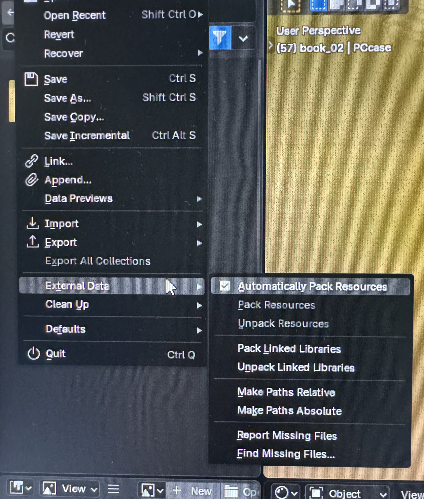
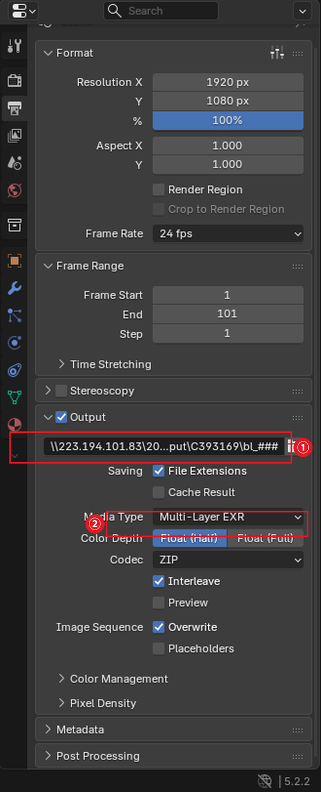
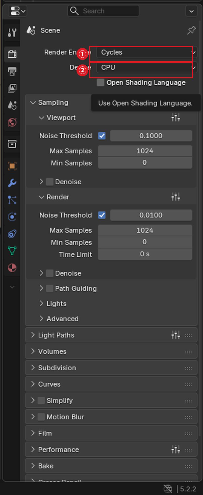

# 🅱 03 · 파일 준비 — 블렌더

> **⏳ 블렌더는 지금 제출하지 마세요 · 2026.10.17**
>
> 실습실 PC마다 블렌더 버전이 달라서, 지금 제출하면 버전 오류로 실패합니다. 학교에서 전 PC에 같은 버전을 설치하는 중입니다.
>
> **아래 3-1 ~ 3-4(파일 준비)는 지금 해두세요.** 제일 오래 걸리는 단계이고, 버전 통일이 끝나면 바로 제출만 하면 됩니다.
>
> 준비가 끝나면 졸업준비위원회를 통해 공지하겠습니다.

---

## 먼저 — 블렌더 버전

**실습실 PC에 설치된 버전과 같거나 낮은 버전**으로 저장해야 합니다.

블렌더는 **상위 호환이 안 됩니다.** 5.2에서 만든 파일은 4.5에서 열리지 않고, 렌더도 되지 않습니다. 이 경우 로그에 이렇게 뜹니다.

```
File written by newer Blender binary (502.45), expect loss of data!
```

현재 실습실 설치 버전은 졸준위 공지 또는 담당자에게 확인하세요.

---

## 3-1. 리소스를 파일 안에 묶기

```
File → External Data → Pack Resources
```



`Automatically Pack Resources` 에 체크해두면 저장할 때마다 자동으로 묶입니다. 한 번만 묶으려면 `Pack Resources` 를 누르세요.

텍스처가 `.blend` 파일 안으로 들어가서 **경로 문제가 아예 사라집니다.** 블렌더는 이 방법이 가장 확실합니다.

확인은 같은 메뉴의 `Report Missing Files` 로 합니다. 못 찾는 파일이 있으면 화면 아래 알림에 뜹니다.

---

## 3-2. 출력 경로 지정

```
Output Properties → Output
```

| 항목 | 값 |
| --- | --- |
| **출력 경로** | `\\223.194.101.83\2026_renderfarm\output\내학번\작업폴더\이름_####` |
| File Format | `PNG` 또는 `OpenEXR` |
| Frame Range | 렌더할 범위 |



**①** `Output` 섹션의 경로칸에 NAS 경로를 넣습니다. **끝에 `####` 를 꼭 붙이세요.**
**②** `Media Type` 은 `PNG` 또는 `OpenEXR` 중에 고릅니다.

### ⚠️ 블렌더는 슬래시 방향이 마야와 반대입니다

```
\\223.194.101.83\...     ✅  역슬래시 두 개로 시작
//223.194.101.83/...     ❌  블렌더에서는 "현재 .blend 파일 위치" 라는 뜻
```

블렌더에서 `//` 는 네트워크 경로가 아니라 **blend 파일 기준 상대경로**를 의미합니다. 마야에서 쓰던 형식을 그대로 붙여넣으면 엉뚱한 곳에 저장됩니다.

### ⚠️ `####` 를 꼭 붙이세요

없으면 프레임 번호가 안 붙어서 **한 파일에 계속 덮어씁니다.** 100프레임을 돌려도 1장만 남습니다.

```
이름_####    →  이름_0001.png, 이름_0002.png, ...   ✅
이름         →  이름.png 하나에 계속 덮어씀          ❌
```

---

## 3-3. 렌더 디바이스를 CPU로

```
Render Properties → Device → CPU
```



**①** `Render Engine` — `Cycles` 일 때만 아래 `Device` 항목이 나옵니다.
**②** `Device` 를 `CPU` 로 둡니다.

---

## 3-4. 저장

**`Ctrl + S`**
