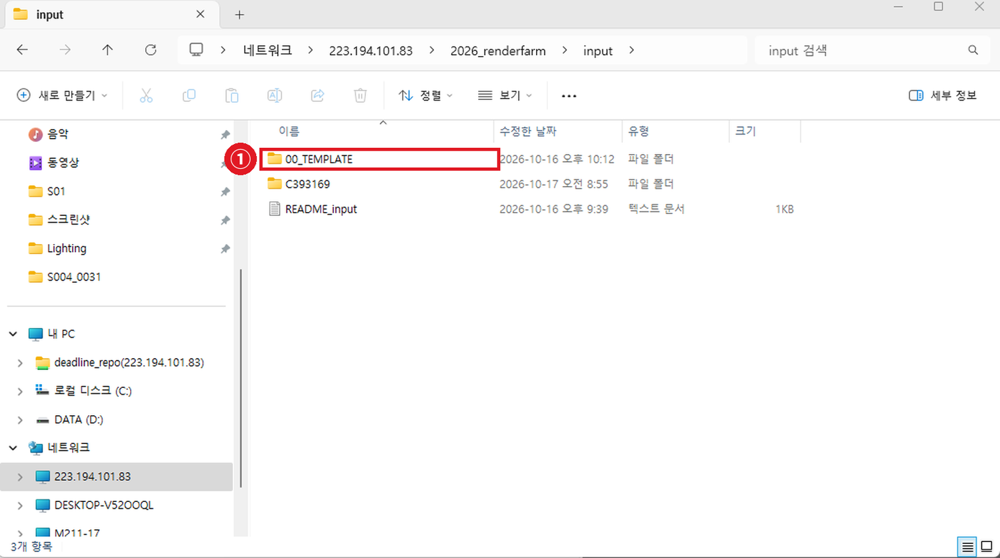

# 📁 04 · NAS에 올리기

---

## 4-1. 내 폴더 찾기

탐색기 주소창에 붙여넣기:

```
\\223.194.101.83\2026_renderfarm\input\
```



> **본인 학번 폴더는 이미 만들어져 있습니다.** 신청한 팀의 학번으로 미리 만들어둡니다. 내 학번 폴더가 안 보이면 아직 신청이 반영되지 않은 것이니 졸업준비위원회에 문의하세요.

---

## 4-2. 작업 폴더 만들기

본인 학번 폴더 안에 **`날짜_작업명`** 폴더를 하나 만드세요.

```
input\
  └ C393169\              ← 내 학번 (이미 있음)
      └ 20261103_final\   ← 이것만 직접 만듭니다
```

```
형식   날짜_작업이름
예시   20261103_final     20261105_retake
```

작업을 여러 번 돌릴 때마다 새로 만드시면 나중에 정리가 쉽습니다.

---

## 4-3. 프로젝트 폴더를 통째로 올리기

만든 폴더 안에 **쓰시던 프로젝트 폴더를 그대로 복사**해 넣으세요.

```
input\C393169\20261103_final\
    └ MyProject\          ← 마야 프로젝트 폴더 통째로
        ├ scenes\
        ├ sourceimages\
        ├ cache\
        └ workspace.mel
```

> **폴더 구조는 쓰시던 그대로 두시면 됩니다.** 렌더팜은 폴더 이름을 따지지 않습니다. 마야 프로젝트 구조를 그대로 올리면 `File → Set Project` 도 바로 됩니다.
>
> 블렌더는 Pack Resources 를 했다면 `.blend` 파일 하나만 올리셔도 됩니다.

### ❌ 씬 파일만 올리면 안 됩니다

씬에는 텍스처가 들어있지 않고 **"텍스처가 어디 있다"는 경로만** 적혀 있습니다. 씬만 올리면 텍스처가 전부 빠져서 회색으로 렌더됩니다.

---

## 4-4. 폴더·파일 이름 규칙

| ✅ 써도 되는 것 | ❌ 쓰면 안 되는 것 |
| --- | --- |
| 영문 소문자, 숫자, 밑줄(`_`) | 한글, 공백, 점(`.`), 특수문자 |

**올리기 전에 프로젝트 안쪽 폴더·파일 이름까지 확인하세요.** 맨 위 폴더만 바꿔도 안쪽에 공백이 있으면 똑같이 실패합니다.

### 왜 안 되나요?

Worker PC가 경로를 **문자 그대로** 읽습니다.

**공백이 있으면** — 경로가 거기서 끊깁니다.

```
.../scenes/s03 c220/ Lighting/shot_v003.mb    ❌
.../scenes/s03_c220/Lighting/shot_v003.mb     ✅
```

**점(`.`)이 있으면** — 확장자로 착각해서 그 지점을 경로의 끝으로 읽습니다.

```
.../scenes.mb/s03_c220/Lighting/shot_v003.mb  ❌
.../scenes/s03_c220/Lighting/shot_v003.mb     ✅
```

> 이미 공백이 잔뜩 들어간 프로젝트라면 손으로 고치지 마세요. `07 · 자주 발생하는 에러` ⑤번에 **한 번에 다 바꿔주는 스크립트**가 있습니다.

---

## 4-5. 출력 폴더도 만들기

```
\\223.194.101.83\2026_renderfarm\output\내학번\날짜_작업명\
```

`output` 쪽에도 본인 학번 폴더는 이미 있습니다. **`날짜_작업명` 폴더만 똑같이 만들어주세요.**

```
output\
  └ C393169\              ← 내 학번 (이미 있음)
      └ 20261103_final\   ← 이것만 직접 만듭니다
```

폴더가 없으면 렌더가 결과물을 쓸 곳이 없습니다.

> **여기 만든 경로를 나중에 쓰게 됩니다.** 어디에 적는지는 프로그램마다 다릅니다.
>
> 🅰 마야 — **제출할 때** 제출 창의 `Output Path` 에 넣습니다. 씬에는 적지 않습니다. → `05 · 렌더 제출하기`
> 🅱 블렌더 — **씬에** `Output Properties → Output` 으로 적어둡니다. → `03 · 파일 준비 — 블렌더`

### ⚠️ 반드시 본인 학번 폴더에

남의 학번 폴더로 경로를 적으면 **그 사람 결과물과 섞입니다.** 경로를 복사해서 쓸 때 학번 부분을 꼭 본인 것으로 바꾸세요.

---

## 4-6. 정리

```
□  input\내학번\날짜_작업명\  폴더를 만들었다
□  프로젝트 폴더를 통째로 넣었다
□  폴더·파일 이름에 한글·공백·점이 없다
□  output\내학번\날짜_작업명\  폴더도 만들었다
□  그 경로를 메모해뒀다 (제출할 때 Output Path 에 넣습니다)
```

> 업로드와 씬 세팅은 **실습실 어느 PC에서나** 할 수 있습니다. 예약 시간이 아니어도 됩니다. **제출만** 예약한 시간에 하시면 됩니다.
