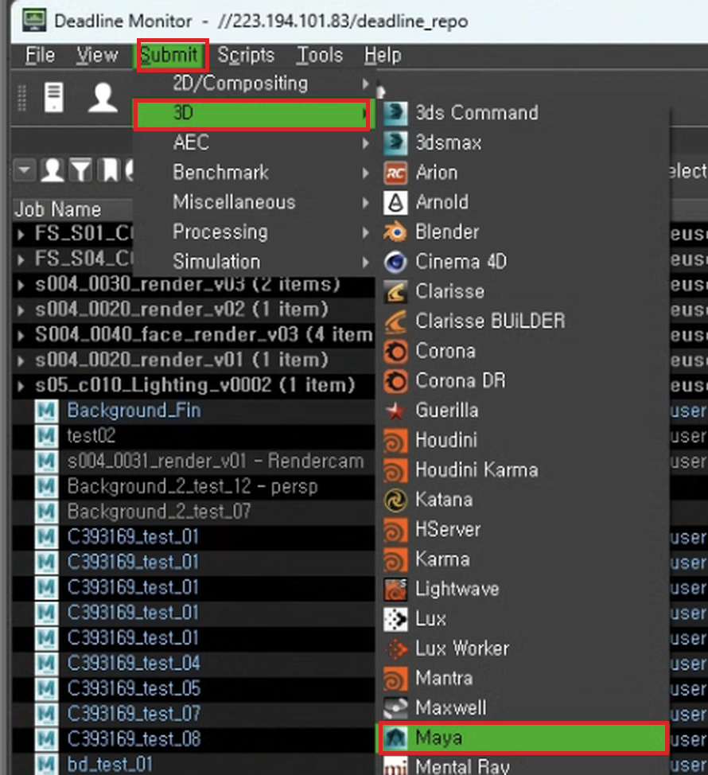
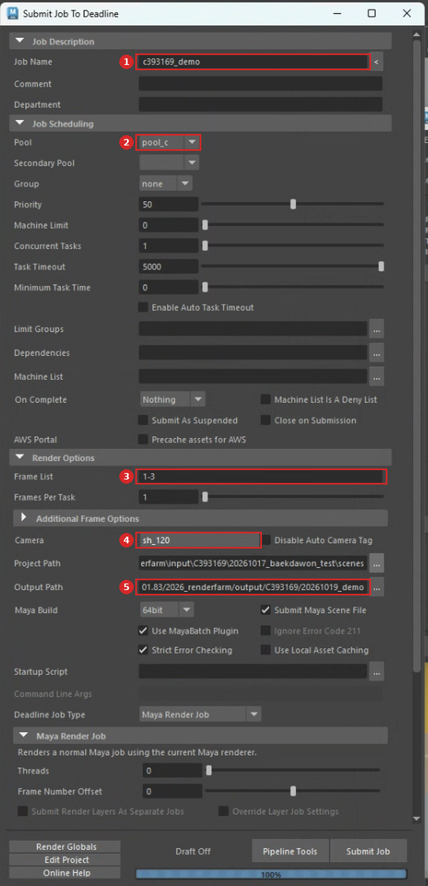
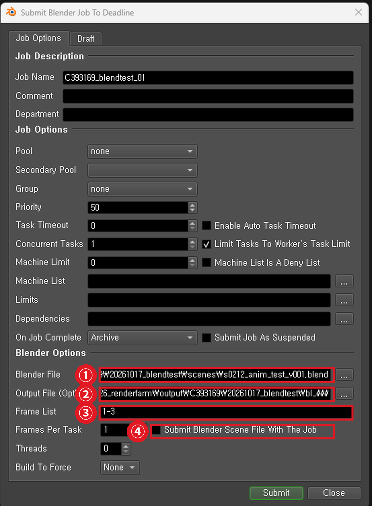

# 🚀 05 · 렌더 제출하기

예약한 시간에 실습실 PC에서 제출합니다.

> **처음엔 반드시 3프레임만.** 경로가 하나라도 틀리면 전체가 실패합니다. 3장이면 1분 안에 확인됩니다.

---

# 🅰 마야

## 5-1. NAS에서 씬 열기

`File → Open Scene` → 파일 이름 칸에 경로를 **직접 입력**:

```
\\223.194.101.83\2026_renderfarm\input\내학번\날짜_작업명\
```

> 마야 탐색기에 네트워크 위치가 안 뜰 수 있습니다. 경로를 쳐서 들어가세요.

## 5-2. 프로젝트 지정

```
File → Set Project → 올린 프로젝트 폴더
```

`scenes` 가 아니라 **그 상위 폴더**(`workspace.mel` 이 있는 곳)입니다.

## 5-3. 제출 창 열기

마야 상단 셸프의 **Deadline 탭 → 초록색 아이콘**을 누르면 제출 창이 열립니다.

```
또는   상단 메뉴 Deadline → Submit Maya To Deadline
```

> 제출 창이 안 보이면 **Deadline Monitor**에서도 됩니다. `Submit → 3D → Maya`
>
> 

## 5-4. 입력할 항목 — 다섯 개만 보면 됩니다



| | 항목 | 값 |
| --- | --- | --- |
| **①** | **Job Name** | 알아보기 쉬운 이름 (예: `c393169_demo`) |
| **②** | **Pool** | **예약한 레인** (`pool_a` ~ `pool_d`) |
| **③** | **Frame List** | 처음엔 `1-3` |
| **④** | **Camera** | **렌더할 카메라** (`persp`·`front`·`top`·`side` 아님) |
| **⑤** | **Output Path** | **NAS output 폴더** |

```
Output Path   //223.194.101.83/2026_renderfarm/output/내학번/날짜_작업명
```

### ⚠️ Project Path 와 Output Path 는 다른 폴더입니다

바로 붙어 있어서 헷갈리기 쉽습니다.

| 칸 | 가리켜야 할 곳 |
| --- | --- |
| `Project Path` | 씬이 있는 **input** 폴더 — `workspace.mel` 이 있는 **프로젝트 폴더** |
| `Output Path` | 결과물을 쓸 **output** 폴더 |

```
✅  .../input/C393169/20261103_final/MyProject
❌  .../input/C393169/20261103_final/MyProject/scenes     ← scenes 까지 넣으면 안 됩니다
```

`Project Path` 는 씬을 열면 보통 자동으로 채워집니다. **`Output Path` 만 직접 넣으시면 됩니다.**

### 🎯 Output Path 와 File name prefix

**절대경로는 한 군데에만 넣으세요.**

| 칸 | 어디에 | 넣을 것 |
| --- | --- | --- |
| `Output Path` | 제출 창 | **폴더 경로** |
| `File name prefix` | Render Settings → Common | **파일 이름만** (예: `shot01`) |

둘 다 전체 경로를 넣으면 **두 경로가 이어 붙습니다.** 실제로 이렇게 나왔습니다.

```
//...output/C393169/20261019_test/beauty///223.194.101.83/...20261017_old/bd.0002.png
└──── Output Path ────────────┘       └──── File name prefix ────────────┘
```

prefix에 파일 이름만 들어가 있으면 `Render Settings` 의 `File name:` 줄이 이렇게 보입니다. **경로가 없는 게 맞습니다.**

```
File name: shot01.0001.png
```

> 자세한 내용은 `07 · 자주 발생하는 에러` ⑫번에 있습니다.

나머지는 **기본값 그대로** 두세요.

```
Group            none  (그대로)
Secondary Pool   비워두기
Priority         50
Concurrent Tasks 1
Frames Per Task  1
Machine Limit    0
```

### ⚠️ Pool을 꼭 확인하세요

예약한 레인과 다른 Pool을 고르면 **예약하지 않은 PC를 쓰게 되어 다른 팀 작업과 겹칩니다.**

`Group` 은 `none` 그대로 두시면 됩니다. 쓰지 않습니다.

### ⚠️ Camera를 빼먹지 마세요

기본 카메라(`persp`)로 렌더되면 **전부 다시 돌려야 합니다.**

### Concurrent Tasks는 1로

한 PC의 CPU를 몇 개로 쪼갤지 정하는 값입니다. 올리면 더 빠를 것 같지만 **반대입니다.**

| 설정 | 결과 |
| --- | --- |
| `1` | 4프레임 약 15분 |
| `4` | 16프레임 약 1시간 30분 |

같은 CPU를 나눠 쓰는 것뿐이고 메모리도 그만큼 더 듭니다.

## 5-5. Submit

**`Submit Job`**

---

# 🅱 블렌더

블렌더는 **Deadline Monitor에서 바로 제출**합니다. 블렌더를 켜지 않아도 됩니다.

```
바탕화면 Deadline Monitor 실행
→ 상단 메뉴 Submit → 3D → Blender
```




| 항목 | 값 |
| --- | --- |
| **Blender File** | NAS의 `.blend` 파일 |
| **Output File** | NAS 출력 경로 (`####` 포함, `\\` 로 시작) |
| **Frame List** | 처음엔 `1-3` |
| **Pool** | 예약한 레인 |

**①** `Blender File`
**②** `Output File`
**③** `Frame List`
**④** `Submit Blender Scene File With The Job` — **체크하지 마세요**

### ❌ Submit Blender Scene File With The Job

체크하면 씬 파일을 Repository에 통째로 복사해 올립니다. 수백 MB짜리가 서버 용량을 잡아먹습니다.

---

## 전체를 돌리기 전에

```
1차   Frame List  1-3     →  결과물 3장 확인  →  OK
2차   Frame List  전체
```

**3장이 제대로 나온 걸 확인한 뒤에** 전체를 돌리세요.

---

## 제출하고 나면

실습실을 떠나도 됩니다. 렌더는 Worker PC들이 알아서 돌립니다.

다만 **실습실 PC를 끄지 마세요.** 끄면 그 PC가 맡은 프레임이 멈춥니다. 꺼진 PC가 보이면 켜주시면 모두의 렌더가 빨라집니다.

> **출력 경로를 메모장에 복사해두세요.** 나중에 결과물 찾을 때 헤매지 않습니다.
