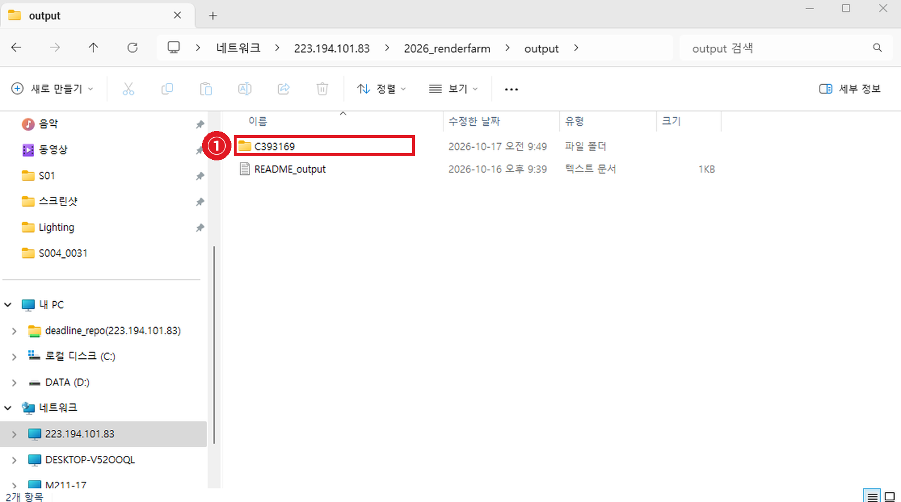

# 📬 06 · 결과 확인하고 받기

---

## 6-1. 진행 상황 보기

바탕화면의 **Deadline Monitor**를 실행하면 내 작업이 보입니다.


위쪽이 Task 목록입니다. 3개 모두 `Completed`, Progress `100%` 이고 각각 다른 Worker(M211-02, 05, 07)에서 돌았습니다. **프레임이 여러 PC에 나뉘어 돌아간 것**입니다.

| 상태 | 의미 |
| --- | --- |
| **Queued** | 대기 중 — 아직 시작 안 함 |
| **Rendering** | 렌더 중 |
| **Completed** | 완료 |
| **Failed** | 실패 |

---

## 6-2. ⚠️ Completed 를 그대로 믿지 마세요

렌더가 중간에 멈춰도 **Completed 로 표시될 때가 있습니다.** Deadline이 일부 오류를 "알 수 없는 오류"로 분류해 무시하기 때문입니다.

**끝났다고 뜨면 반드시 결과물 장수를 세어보세요.**

```
10프레임 제출  →  결과물 10장?  →  OK
               →  7장?          →  문제 있음 (07 페이지 참고)
```

실패를 알아보는 다른 신호:

| 지표 | 실패 신호 |
| --- | --- |
| Task Time | 몇 초 만에 끝남 |
| 평균 CPU 사용률 | 1% 수준 |
| Task 로그 | `% done` 진행률이 아예 없음 |

---

## 6-3. 결과물 받기

```
\\223.194.101.83\2026_renderfarm\내학번\output\날짜_작업명\
```



**①** 본인 학번 폴더 안에 결과물이 쌓입니다.

---

## 6-4. 🧹 끝나면 폴더를 비워주세요

결과물을 본인 저장장치로 옮기고 **NAS 폴더는 비워주세요.**

EXR 시퀀스는 한 프로젝트가 수십 GB까지 갑니다. 안 치우면 NAS가 차서 **다른 사람이 렌더를 못 합니다.**

```
□  결과물을 외장하드/개인 저장소로 복사
□  복사된 것 확인
□  NAS output 폴더 비우기
□  input 폴더도 다 썼으면 비우기
```
