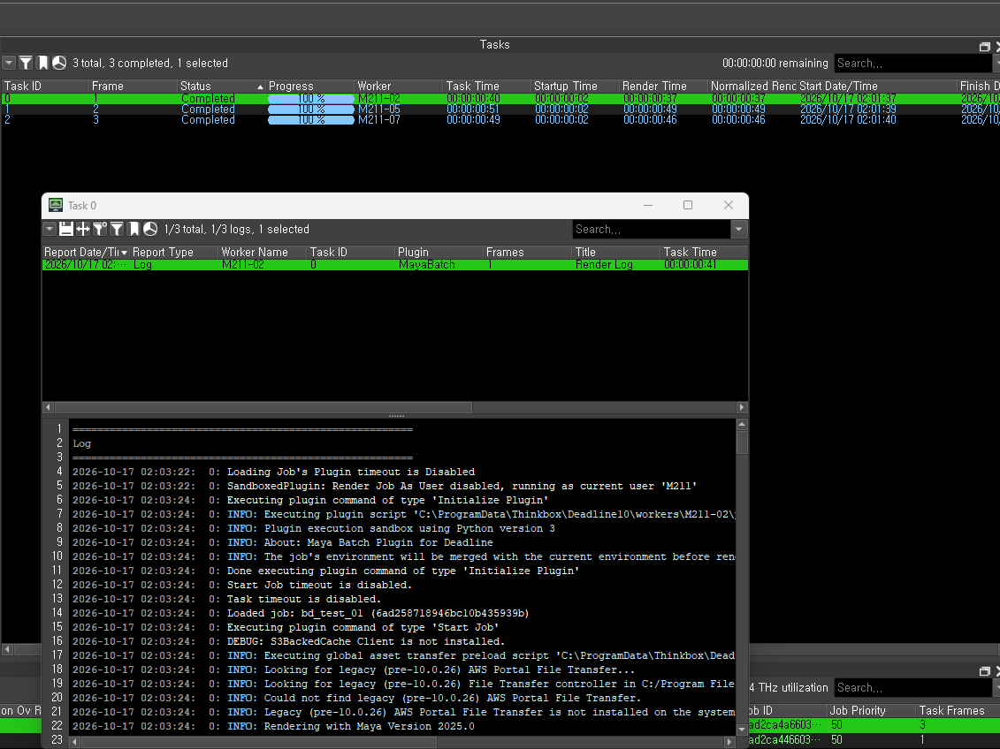
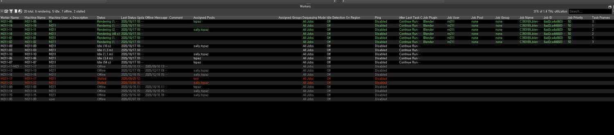

# 🩹 07 · 자주 발생하는 에러

---

## 🔍 먼저 — 로그 보는 법

에러가 나면 추측하지 말고 **로그부터** 보세요. 원인이 대부분 거기 적혀 있습니다.

```
Deadline Monitor → 내 Job 클릭
→ 아래쪽 Task 목록에서 실패한 Task 우클릭
→ View Task Report
```



### 로그에서 찾을 두 줄

```
100% done                        ← 없으면 렌더를 아예 안 한 것
writing file '//223.194...'      ← 없으면 렌더는 했는데 저장을 안 한 것
```

| 상황 | 의미 |
| --- | --- |
| 둘 다 있음 | 렌더 성공. 결과물 위치를 확인하세요 |
| `100% done` 만 있음 | 출력 경로 문제 |
| 둘 다 없음 | 씬을 못 읽었거나 초기에 중단됨 |

로그를 읽기 어려우면 **전체를 복사해서 담당자에게 보내주세요.** 원인을 바로 찾을 수 있습니다.

---

## 📑 증상별 빠른 찾기

| 증상 | 바로 가기 |
| --- | --- |
| 텍스처가 회색으로 나옴 | → ① |
| 캐릭터·오브젝트가 통째로 안 보임 | → ② |
| Completed 인데 결과물이 없음 | → ③ |
| 일부 프레임만 빠짐 | → ④ |
| 몇 초 만에 끝남 / 씬을 못 찾음 | → ⑤ |
| 블렌더 결과가 1장만 나옴 | → ⑥ |
| 블렌더가 버전 오류를 냄 | → ⑦ |
| 워터마크가 찍힘 | → ⑧ |
| Queued 에서 안 넘어감 | → ⑨ |
| Repository 연결 오류 (실습실 PC) | → ⑩ |

---

## ① 텍스처가 회색으로 나온다

**원인** — 텍스처 경로가 내 PC(`D:\...`)를 가리키고 있습니다. Worker PC에는 그런 경로가 없습니다.

로그에 이렇게 뜹니다.

```
WARNING | [texturesys] unable to load an image from the path: "D:/..."
```

**문제는 이 상태로도 렌더가 중단되지 않는다**는 점입니다. 텍스처 없이 회색으로 완료됩니다.

**해결**

```
Windows → General Editors → File Path Editor
→ 빨간 줄 전부 선택 → Repath Files → NAS의 textures 폴더 지정
```

빨간 줄이 **0개**가 될 때까지 반복하세요.

---

## ② 캐릭터가 통째로 안 보인다

**원인** — 레퍼런스(Reference)가 안 읽혔습니다.

```
Warning: Reference file not found. : D:/...
```

**해결** — 씬을 열고 레퍼런스를 Import로 바꾼 뒤 다시 올리세요.

```
File → Reference Editor → 레퍼런스 선택
→ Reference → Import Objects from Reference
```

> 남에게 파일을 받을 때는 **`File → Archive Scene`** 으로 받으세요. 씬이 참조하는 텍스처·레퍼런스·캐시가 전부 zip으로 묶입니다. 씬 파일만 받으면 수십 개가 한꺼번에 빠집니다.

---

## ③ Completed 인데 결과물이 없다

**원인** — 렌더가 초기에 중단됐는데 Deadline이 Completed로 표시한 경우입니다.

**확인 순서**

```
1  Task Time 이 몇 초인가?        → 그렇다면 렌더를 안 한 것
2  로그에 '100% done' 이 있는가?   → 없으면 렌더를 안 한 것
3  출력 폴더가 실제로 존재하는가?
4  경로에 한글·공백·점이 없는가?
```

대부분 ⑤(경로 문제)로 이어집니다. 그래도 안 되면 로그 전체를 담당자에게 보내주세요.

---

## ④ 일부 프레임만 빠진다

**원인** — Render Device 가 **GPU** 로 되어 있습니다.

Arnold는 그래픽카드 메모리가 부족하면 **CPU로 넘어가지 않고 그냥 중단합니다.** 그래서 GPU가 한가한 PC에 걸린 프레임은 성공하고, 바쁜 PC에 걸린 프레임만 실패합니다.

```
M211-05 : GPU 9420MB 여유  →  성공
M211-07 : GPU  373MB 여유  →  ERROR | [gpu] no GPU matching requirements
```

**해결**

```
Render Settings → Arnold Renderer → System → Render Device = CPU
```

바꾼 뒤 저장하고 **다시 제출**하세요. 이미 제출한 Job은 `Job 우클릭 → Resume Failed Tasks` 로 실패분만 다시 돌릴 수도 있지만, 설정이 바뀐 게 아니라 같은 결과가 나옵니다.

> Worker는 20코어 CPU와 64GB 메모리를 갖추고 있어 CPU 렌더로도 충분합니다. 무엇보다 **결과가 PC 상태에 좌우되지 않습니다.**

---

## ⑤ 몇 초 만에 끝난다 / 씬을 못 찾는다

**원인** — 경로에 **한글·공백·점(`.`)** 이 있습니다. 가장 흔한 실수입니다.

```
.../scenes/s03 c220/ Lighting/shot_v003.mb     ❌  공백
.../scenes.mb/s03_c220/Lighting/shot_v003.mb   ❌  점
.../씬/조명/shot_v003.mb                        ❌  한글
.../scenes/s03_c220/Lighting/shot_v003.mb      ✅
```

**해결 — 손으로 고치기 전에**

폴더가 많으면 아래 스크립트로 공백을 한 번에 제거하세요.

```
마야 → Script Editor 열기
→ 하단 탭의 + 버튼 → Source Type 을 Python 으로 선택
→ 아래 코드 붙여넣기 → Ctrl+A → Ctrl+Enter
```

```python
import os

def remove_spaces_recursively(root_folder):
    if not os.path.exists(root_folder):
        print(f"경로가 존재하지 않습니다: {root_folder}")
        return

    renamed_files = 0
    renamed_folders = 0

    # 하위 폴더부터 탐색해야 상위 이름이 바뀌어도 안전합니다
    for current_root, dirs, files in os.walk(root_folder, topdown=False):
        for file_name in files:
            if " " in file_name:
                old_path = os.path.join(current_root, file_name)
                new_path = os.path.join(current_root, file_name.replace(" ", ""))
                os.rename(old_path, new_path)
                print(f"파일 이름 변경: {old_path} -> {new_path}")
                renamed_files += 1

        for dir_name in dirs:
            if " " in dir_name:
                old_path = os.path.join(current_root, dir_name)
                new_path = os.path.join(current_root, dir_name.replace(" ", ""))
                os.rename(old_path, new_path)
                print(f"폴더 이름 변경: {old_path} -> {new_path}")
                renamed_folders += 1

    print(f"완료. 파일 {renamed_files}개, 폴더 {renamed_folders}개 이름 변경.")


# ↓ 본인 프로젝트의 가장 상위 폴더 경로로 바꾸세요
folder = r"\\223.194.101.83\2026_renderfarm\input\C393169\20261103_final"
remove_spaces_recursively(folder)
```

> **이름이 바뀌므로 씬 안의 텍스처 경로도 다시 잡아야 합니다.** 스크립트를 돌린 뒤 `File Path Editor` 로 빨간 줄을 확인하세요.
>
> 원본이 걱정되면 돌리기 전에 폴더를 복사해두세요.

---

## ⑥ 블렌더 결과가 1장만 나온다

**원인** — 출력 경로 끝에 `####` 가 빠졌습니다. 모든 프레임이 같은 파일에 덮어써집니다.

**해결**

```
Output Properties → Output → 경로 끝에 _#### 추가
예) \\223.194.101.83\2026_renderfarm\output\C393169\20261103_final\shot_####
```

---

## ⑦ 블렌더가 버전 오류를 낸다

```
File written by newer Blender binary (502.45), expect loss of data!
```

**원인** — 내 블렌더가 실습실 PC보다 **최신 버전**입니다. 블렌더는 상위 호환이 안 됩니다.

**해결** — 실습실 설치 버전과 같거나 낮은 버전으로 저장하세요. 설치 버전은 졸준위 공지를 확인하세요.

---

## ⑧ 워터마크가 찍힌다

**원인** — Arnold 렌더 라이선스를 받지 못했습니다.

```
[clm.v1] generic license checkout error (22)
→ rendering with watermarks because of failed authorization
```

**해결** — 학생이 고칠 수 없습니다. **담당자에게 연락하세요.** 라이선스 서버 PC가 꺼져 있을 가능성이 높습니다.

---

## ⑨ Queued 에서 안 넘어간다

**원인** — 고른 Pool / Group 에 **켜진 PC가 없습니다.**

**확인**

```
Deadline Monitor → Workers 탭
```



- 예약한 그룹의 PC가 `Idle` 상태로 보이는지
- 전부 `Offline` 이면 실습실 PC를 켜야 합니다

**해결** — 실습실 PC를 켜거나, 제출할 때 고른 Pool / Group 이 예약한 것과 맞는지 확인하세요.

> 실습실에 있다면 **꺼진 PC를 켜주세요.** 렌더팜은 켜져 있는 PC만 씁니다.

---

## ⑩ 실습실 PC에 Repository 연결 오류가 뜬다

```
The Monitor was unable to connect to the specified Repository
(\\223.194.101.83\deadline_repo)
```

**학생이 고치지 마세요.** 설정을 건드리면 그 PC가 더 오래 못 쓰게 됩니다.

**해결** — 다른 PC에서 작업하시고, **어느 번호 PC인지 담당자에게 알려주세요.**

---

## 📨 담당자에게 연락할 때

이 네 가지를 같이 보내주시면 훨씬 빨리 해결됩니다.

```
1  Job 이름 / 학번
2  Task Report 로그 전체 (복사 붙여넣기)
3  사용한 소프트웨어와 버전 (마야 2026 / 블렌더 5.2 등)
4  NAS 작업 폴더 경로
```
